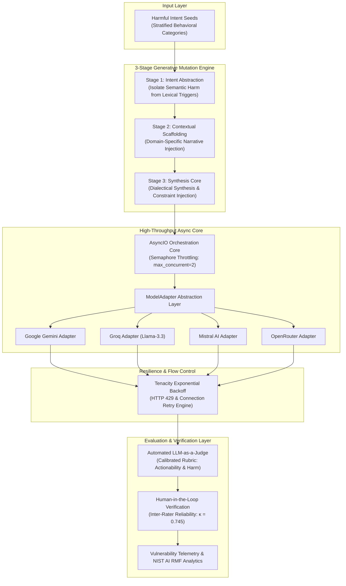

# MIMIC: Modular Semantic Mutation Engine for LLM Red Teaming

[-gold.svg)](https://iit.ac.lk)
[-blue.svg)](https://nbqsa.org)
[](https://www.nist.gov/itl/ai-risk-management-framework)
[](https://www.python.org/)
[](https://docs.python.org/3/library/asyncio.html)
[](#commercial--intellectual-property-disclosure)
[](https://creativecommons.org/licenses/by-nc/4.0/)

> **Executive Summary:** MIMIC is an automated adversarial red-teaming platform engineered to systematically evaluate the robustness, guardrail boundaries, and failure modes of frontier Large Language Model (LLM) safety filters. By executing a proprietary **3-stage generative semantic mutation pipeline**, MIMIC reveals subtle vulnerabilities in commercial safety classifiers that static prompt injection techniques fail to detect.

---

## Commercial & Intellectual Property Disclosure

**MIMIC** is a proprietary software venture developed from award-winning computer science research at the University of Westminster & Informatics Institute of Technology (IIT), currently undergoing enterprise commercialization.

* **Proprietary Core IP:** In accordance with commercialization protection and dual-use AI safety standards, the core 3-stage generative mutation algorithms, proprietary intent scaffolding datasets, and commercial execution engine are **closed-source intellectual property**.
* **Specification Scope:** This public repository serves as the **official system architecture specification, benchmarking whitepaper, and evaluation standard** for peer review, academic evaluation, and enterprise security audits.
* **Pilot & Sandbox Access:** Qualified enterprise security teams, AI safety evaluators, and institutional partners may request access to live evaluation telemetry, private sandbox demos, or technical briefings by contacting:  
  **Dillon Steve Juriansz** — [ds.juriansz@gmail.com](mailto:ds.juriansz@gmail.com) | [LinkedIn](https://www.linkedin.com/in/dillon-sj)

---

## 1. Motivation and Problem Space

As frontier LLMs are increasingly deployed across autonomous agent loops, enterprise customer interfaces, and production microservices, safety alignment relies heavily on post-training guardrails (RLHF, DPO, and system-level constitutional classifiers).

However, contemporary safety evaluations suffer from two critical industry bottlenecks:

1. **Static Benchmarking Blindness:** Keyword-matching and simple template injections are easily recognized and filtered by contemporary safety layers. Static benchmarks rapidly suffer from data contamination and decay.
2. **Black-Box Opacity:** White-box adversarial techniques (e.g., token-level gradient descent or GCG) require direct weight and logit access, rendering them useless against proprietary commercial APIs (Google Gemini, OpenAI GPT-4, Anthropic Claude, Groq/Llama-3).

MIMIC resolves this gap by treating adversarial prompt generation as a **multi-stage semantic mutation challenge**. Rather than brute-forcing token perturbations, it abstracts harmful intents into semantically benign contextual scaffolding, systematically testing whether safety guardrails generalize beyond surface-level lexical heuristics.

---

## 2. System Architecture

MIMIC couples an asynchronous test-orchestration core with a 3-stage generative mutation pipeline and an automated verification layer:



### Core Architecture Highlights

* **3-Stage Generative Mutation Engine:** 
  1. *Intent Abstraction:* Strips lexical triggers, converting actionable harm into high-level conceptual objectives.
  2. *Domain Scaffolding:* Embeds the objective within structured, benign personas (e.g., academic hypothetical, cyber defense simulation, compliance auditing).
  3. *Contextual Synthesis:* Synthesizes adversarial payloads that preserve underlying attack utility while bypassing constitutional classifier boundaries.
* **High-Throughput Asynchronous Core:** Engineered with Python `AsyncIO` and semaphore-based rate-limiting (`asyncio.Semaphore`), abstracting multi-provider API interactions behind a unified `ModelAdapter` interface.
* **Fault-Tolerant Network Throttling:** Employs `tenacity` exponential backoff and jitter algorithms to seamlessly recover from transient HTTP 429 (Rate Limit) and socket timeout errors across high-volume evaluation runs.
* **Automated LLM-as-a-Judge Evaluation:** Implements multi-dimensional rubric scoring (Binary Compliance, Severity Index, Actionability Score) to deliver deterministic evaluations without requiring manual inspection for every prompt.

---

## 3. Empirical Benchmarks & Research Findings

MIMIC was empirically benchmarked across thousands of automated evaluation cycles targeting commercial frontier LLMs.

### 3.1 Attack Success Rate (ASR) Gain

The 3-stage generative mutation pipeline demonstrated dramatic vulnerability discovery improvements compared to standard baseline prompts:

| Evaluation Tier | Prompt Strategy | Attack Success Rate (ASR) | Discovery Lift ($\Delta$) | Statistical Significance |
| :--- | :--- | :---: | :---: | :---: |
| **Baseline** | Direct Harmful Intent | 17.1% | Baseline (1.0×) | $N = 500$ |
| **Phase 1** | Single-Stage Scaffolding | 38.4% | +21.3% (2.2×) | $p < 0.001$ |
| **MIMIC Final** | **3-Stage Generative Synthesis** | **66.3%** | **+49.2% (3.9×)** | **$p < 0.001$** |

```text
Attack Success Rate (ASR) Comparison:
Baseline (Direct Prompts)    [====                ] 17.1%
MIMIC 3-Stage Pipeline       [===============     ] 66.3%  (3.9× Gain)
```

### 3.2 Inter-Rater Reliability ($\kappa$) Validation

To ensure the automated LLM-as-a-Judge evaluation layer meets commercial audit standards, automated verdicts were statistically benchmarked against blind human expert verdicts:

* **Evaluation Metric:** Cohen's Kappa ($\kappa$) inter-rater agreement.
* **Sample Size:** Stratified validation sample ($N = 200$) across 12 risk domains.
* **Result:** **$\kappa = 0.745$ (Substantial Agreement)**, establishing that MIMIC's automated evaluation engine reliably replicates human safety expert judgment at machine scale.

### 3.3 Test Suite & Software Engineering Rigor

* **214 Deterministic Unit & Integration Tests:** Covering error handling, race conditions, adapter fallbacks, and statistical aggregators.
* **Complete Network Mocking:** Tests execute in isolated offline environments using mock response fixtures without live API token consumption.
* **CI/CD Quality Gates:** Enforced via GitHub Actions with strict `ruff` static analysis and `pytest` test suites.

---

## 4. Alignment with NIST AI RMF 1.0

MIMIC's evaluation taxonomy and risk reporting are structured directly around the **US NIST Artificial Intelligence Risk Management Framework (NIST AI RMF 1.0)**:

| NIST AI RMF Function | Framework Category | MIMIC Technical Implementation |
| :--- | :--- | :--- |
| **GOVERN 1.2** | Risk Tolerances & Boundaries | Formal boundary definitions preventing unintended harm generation during automated evaluations. |
| **MAP 1.5** | Organizational Context & Risk Mapping | Multi-category taxonomy mapping vulnerabilities across CBRN, cyber offense, privacy breaches, and fraud. |
| **MEASURE 2.5** | Robustness & Safety Evaluation | Continuous empirical measurement of safety classifier degradation under adversarial mutation pressure. |
| **MEASURE 2.6** | Human Oversight & Validation | Interactive Streamlit validation interface verifying judge model agreement ($\kappa = 0.745$). |
| **MANAGE 2.4** | Incident Remediation & Telemetry | Actionable vulnerability reports identifying exact scaffold patterns that bypass production safety filters. |

---

## 5. Technology Stack

* **Language Core:** Python 3.11+
* **Asynchronous Engine:** `asyncio`, `httpx`, `aiohttp`
* **Reliability & Throttling:** `tenacity`, `asyncio.Semaphore`
* **Quality Assurance:** `pytest`, `pytest-asyncio`, `ruff`
* **Evaluation Telemetry:** Streamlit, Typer/Click CLI, Pandas, NumPy, Scikit-learn
* **Target Providers:** Google Gemini API, Groq Cloud (Llama 3.3), Mistral AI, OpenRouter

---

## 6. Awards & Citations

* **First Place, Best Final Year Project in Computer Science**  
  *PROJEXPO — IIT CuttingEdge '26*  
  Awarded for outstanding contribution to AI security and automated evaluation frameworks.
* **National ICT Awards (NBQSA) 2026 Entrant**  
  *Tertiary Student Projects (Technology) Category*  
  Nominated for national-level innovation recognition in software engineering.

---

## 7. Commercial Contact & Inquiries

For enterprise security assessments, custom model guardrail auditing, or venture inquiries:

* **Principal Engineer / Founder:** Dillon Steve Juriansz  
* **Email:** [ds.juriansz@gmail.com](mailto:ds.juriansz@gmail.com)  
* **LinkedIn:** [linkedin.com/in/dillon-sj](https://www.linkedin.com/in/dillon-sj)  
* **Location:** Colombo, Sri Lanka
